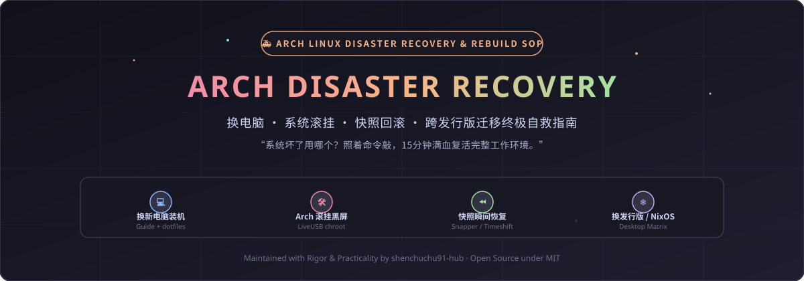

<div align="center">

  <!-- 本地自托管救援动态 Banner -->
  

  <br><br>

  <p align="center">
    
    
    
    
    
  </p>

  <p align="center">
    <i>换电脑 · 系统滚挂 · 快照回滚 · 跨发行版迁移终极自救与复刻手册 (SOP)</i>
    <br>
    <sub>“系统坏了不用慌，查阅本手册照着敲命令，15分钟满血复活你的全部开发与游戏环境。”</sub>
  </p>

</div>

---

## 📑 目录全景 (Table of Contents)

- [🧭 遇到故障 / 换电脑：我该用哪个仓库？（终极速查决策表）](#-遇到故障--换电脑我该用哪个仓库终极速查决策表)
- [💻 场景一：换新电脑 / 纯净裸机 15 分钟极速复原流水线](#-场景一换新电脑--纯净裸机-15-分钟极速复原流水线)
  - [第 1 步：底层系统安装 (OS Base)](#第-1-步底层系统安装-os-base)
  - [第 2 步：硬件驱动与混合显卡 (Drivers & Prime)](#第-2-步硬件驱动与混合显卡-drivers--prime)
  - [第 3 步：一键拉回全部软件与专属桌面 (All-in-One Dotfiles)](#第-3-步一键拉回全部软件与专属桌面-all-in-one-dotfiles)
- [🛠️ 场景二：Arch 滚挂黑屏 / 进不去系统 紧急救砖 SOP](#️-场景二arch-滚挂黑屏--进不去系统-紧急救砖-sop)
  - [1. 使用 LiveUSB 快速挂载并进入 arch-chroot](#1-使用-liveusb-快速挂载并进入-arch-chroot)
  - [2. 常见致命故障针对性修复](#2-常见致命故障针对性修复)
- [⏪ 场景三：快照回滚实战 (Timeshift / Btrfs / Snapper)](#-场景三快照回滚实战-timeshift--btrfs--snapper)
- [❄️ 场景四：换系统 / 体验其他发行版 (NixOS / Fedora 等)](#️-场景四换系统--体验其他发行版-nixos--fedora-等)
- [🎯 场景五：游戏与双系统专项故障速查](#-场景五游戏与双系统专项故障速查)
- [🛡️ 数据安全守则与许可证 (Disclaimer & License)](#️-数据安全守则与许可证-disclaimer--license)

---

## 🧭 遇到故障 / 换电脑：我该用哪个仓库？（终极速查决策表）

下表为你明确指引在不同生命周期阶段所需要调用的仓库与关键动作：

| 遇到什么情况？ | 核心痛点与现象 | 应该使用哪个仓库？ | 核心执行命令 / 动作 |
| :--- | :--- | :--- | :--- |
| **💻 换了新电脑 / 格式化重装** | 裸机无系统，需要完整复原现有工作环境 | **[`Arch-Linux-Guide`](https://github.com/shenchuchu91-hub/Arch-Linux-Guide)**<br>+ **[`dotfiles`](https://github.com/shenchuchu91-hub/dotfiles)** | 1. 照指南装好底座与驱动<br>2. 运行 `~/dotfiles/install.sh` |
| **🛠️ 系统滚挂 / 黑屏无法开机** | 更新后内核崩了、进 GRUB rescue、启动卡死 | **本项目 (`Arch-Disaster-Recovery`)** | 插入 LiveUSB，运行 `chroot-mount.sh`，重新生成引导 |
| **🪟 桌面配置搞乱 / 想恢复初始** | 删错配置、快捷键失效、主题错乱 | **[`dotfiles`](https://github.com/shenchuchu91-hub/dotfiles)** | `cd ~/dotfiles && git pull && ./install.sh` |
| **⏪ 使用了系统快照之后** | 刚执行了 Timeshift / Snapper 回滚 | **[`dotfiles`](https://github.com/shenchuchu91-hub/dotfiles)** | 重新跑一遍 `./install.sh` 确保软链接正常 |
| **❄️ 换到其他 Linux (NixOS 等)** | 想在 NixOS / Fedora 上用上 Niri 或 Hyprland | **[`Linux-Desktop-Matrix`](https://github.com/shenchuchu91-hub/Linux-Desktop-Matrix)** | 运行 `./setup.sh` 或引入 Nix Flake 模块 |
| **🎮 笔记本游戏没调用独显** | 只有核显在跑、帧率低、需要 144Hz 锁帧 | **[`moe-game-launcher`](https://github.com/shenchuchu91-hub/moe-game-launcher)** | 使用 `moe-game` 自动委派 Prime Offload |
| **🎯 SCPSL 准星偏移 / 游戏掉帧** | Unity 引擎多核分配不均、Wayland 准星脱节 | **[`SCPSL-ArchLinux-Optimization`](https://github.com/shenchuchu91-hub/SCPSL-ArchLinux-Optimization)** | 部署 Unity 优化配置文件 |
| **🪟 双系统时间差 8 小时 / NTFS 盘只读** | Windows 与 Arch 时间互相冲突、Steam 库挂载崩 | **[`Linux-DualBoot-Steam-Guide`](https://github.com/shenchuchu91-hub/Linux-DualBoot-Steam-Guide)** | 执行时间 RTC 同步与 NTFS 读写挂载规则 |

---

## 💻 场景一：换新电脑 / 纯净裸机 15 分钟极速复原流水线

换了新电脑或更换了固态硬盘后，无需手动到处找软件，按照以下标准流水线操作：

### 第 1 步：底层系统安装 (OS Base)
> 📖 **完整指南参考**：[`Arch-Linux-Guide`](https://github.com/shenchuchu91-hub/Arch-Linux-Guide)

1. 使用 Arch Linux 官方 ISO 制作启动盘并引导进入 Live 环境；
2. 连接 Wi-Fi 并同步时钟：
   ```bash
   iwctl --passphrase <wifi密码> station wlan0 connect <wifi名>
   timedatectl set-ntp true
   ```
3. 分区与文件系统（UEFI 模式）：
   - `/dev/nvme0n1p1` -> 1GB FAT32 (挂载为 `/boot`)
   - `/dev/nvme0n1p2` -> 剩余空间 Ext4 / Btrfs (挂载为 `/`)
4. 安装核心系统底座：
   ```bash
   pacstrap -K /mnt base base-devel linux linux-headers linux-firmware networkmanager git fish sudo vim
   genfstab -U /mnt >> /mnt/etc/fstab
   ```
5. 进入系统并配置时区与 GRUB 双系统引导：
   ```bash
   arch-chroot /mnt
   ln -sf /usr/share/zoneinfo/Asia/Shanghai /etc/localtime
   hwclock --systohc
   # 创建你的日常用户并赋予 sudo 权限（请把 <你的用户名> 换成自己的用户名）
   useradd -m -G wheel -s /usr/bin/fish <你的用户名>
   passwd <你的用户名>
   EDITOR=vim visudo # 取消 %wheel ALL=(ALL:ALL) ALL 前面的注释
   
   # 安装引导
   pacman -S grub efibootmgr os-prober
   grub-install --target=x86_64-efi --efi-directory=/boot --bootloader-id=Arch
   grub-mkconfig -o /boot/grub/grub.cfg
   systemctl enable NetworkManager
   exit
   reboot
   ```

### 第 2 步：硬件驱动与混合显卡 (Drivers & Prime)
重启进入新系统后，安装驱动环境：
```bash
sudo pacman -S intel-ucode intel-media-driver nvidia-dkms nvidia-utils lib32-nvidia-utils pipewire wireplumber pipewire-audio pipewire-pulse
```

### 第 3 步：一键拉回全部软件与专属桌面 (All-in-One Dotfiles)
> 🌸 **自动化部署**：[`dotfiles`](https://github.com/shenchuchu91-hub/dotfiles)

直接克隆个人专属 dotfiles 仓库：
```bash
git clone https://github.com/shenchuchu91-hub/dotfiles.git ~/dotfiles
cd ~/dotfiles
chmod +x install.sh
./install.sh
```

#### 执行后会自动完成：
- 读取 `pkglist-native.txt`，自动补齐 Niri、Foot、Kitty、Fish、Starship、Fuzzel、Satty、Steam、DMS 等所有原生包；
- 提示安装 AUR 常用工具；
- 自动软链接配置到 `~/.config/{niri, dms, fish, foot, kitty, yazi, ...}`；
- **整机配置立刻 100% 还原，与故障前完全一致！**

---

## 🛠️ 场景二：Arch 滚挂黑屏 / 进不去系统 紧急救砖 SOP

如果更新后开机卡在黑屏、提示内核错误，或 GRUB 引导损坏：

### 1. 使用 LiveUSB 快速挂载并进入 arch-chroot
1. 插入任何制作好的 Arch Linux 启动 U 盘开机；
2. 联网后，直接克隆或手动下载本仓库内的救灾脚本：
   ```bash
   curl -O https://raw.githubusercontent.com/shenchuchu91-hub/Arch-Disaster-Recovery/main/scripts/chroot-mount.sh
   chmod +x chroot-mount.sh
   ./chroot-mount.sh
   ```
   *(或者手动执行标准挂载)*：
   ```bash
   mount /dev/nvme0n1p2 /mnt       # 根目录
   mount /dev/nvme0n1p1 /mnt/boot  # EFI 目录
   arch-chroot /mnt
   ```

### 2. 常见致命故障针对性修复

#### 故障 A：内核更新中断 / Initramfs 损坏
```bash
# 重新安装内核并强行重建所有 initramfs 引导镜像
pacman -Syu linux linux-headers
mkinitcpio -P
grub-mkconfig -o /boot/grub/grub.cfg
exit
reboot
```

#### 故障 B：NVIDIA 独显驱动新版本与内核不兼容导致开机黑屏
```bash
# 方法一：切换至 LTS 稳定内核兜底
pacman -S linux-lts linux-lts-headers
grub-mkconfig -o /boot/grub/grub.cfg

# 方法二：从本地 pacman 缓存一键降级驱动版本
ls /var/cache/pacman/pkg/nvidia-dkms*
pacman -U /var/cache/pacman/pkg/nvidia-dkms-<旧版本号>.pkg.tar.zst
```

#### 故障 C：GRUB 引导文件丢失 / 启动项不见了
```bash
grub-install --target=x86_64-efi --efi-directory=/boot --bootloader-id=Arch --recheck
grub-mkconfig -o /boot/grub/grub.cfg
```

---

## ⏪ 场景三：快照回滚实战 (Timeshift / Btrfs / Snapper)

如果你配置了快照体系，可以在无法进入图形界面的情况下直接从 TTY 或 LiveUSB 回滚：

### 1. Timeshift 命令行快速回滚
```bash
# 查看所有可用快照编号
sudo timeshift --list

# 恢复指定编号的快照 (如第 0 个)
sudo timeshift --restore --snapshot '<快照名>'
```

### 2. Btrfs / Snapper 快照回滚
```bash
# 列出快照
sudo snapper list

# 回滚到指定快照编号
sudo snapper rollback <快照编号>
reboot
```

> ⚠️ **回滚后的收尾动作**：快照恢复后，请执行 `cd ~/dotfiles && ./install.sh`，重新校准一次个人配置的软链接，确保最新的快捷键与主题保持生效。

---

## ❄️ 场景四：换系统 / 体验其他发行版 (NixOS / Fedora 等)

如果换了电脑，或者你想体验其他发行版（如 NixOS、Fedora、Debian）：

请前往 **[`Linux-Desktop-Matrix`](https://github.com/shenchuchu91-hub/Linux-Desktop-Matrix)** 仓库：
```bash
git clone https://github.com/shenchuchu91-hub/Linux-Desktop-Matrix.git
cd Linux-Desktop-Matrix
./setup.sh
```
- **自动识别新系统**：根据检测到的发行版给出对应的包管理指令；
- **自由挑选桌面**：按需选择 **Niri (Shorin 大老师定制版)**、**Niri (官方纯净原版)**、**Hyprland**、**GNOME** 或 **DMS**；
- **NixOS 声明式引入**：如果你装了 NixOS，直接在 `flake.nix` 或 `home.nix` 中引用仓库里的 `distros/nixos/home-manager/` 模块，无需手动编写。

---

## 🎯 场景五：游戏与双系统专项故障速查

| 故障现象 | 根因说明 | 解决入口 |
| :--- | :--- | :---: |
| **Windows 和 Arch 时间总差 8 小时** | Windows 使用本地时间 (Local Time)，Linux 使用世界标准时 (UTC) | 前往 [`Linux-DualBoot-Steam-Guide`](https://github.com/shenchuchu91-hub/Linux-DualBoot-Steam-Guide) 开启 RTC 同步 |
| **Windows NTFS 机械/固态盘在 Linux 下只读锁死** | Windows 快速启动 (Fast Startup) 未完全关闭导致休眠标记占用 | 查看 [`Linux-DualBoot-Steam-Guide`](https://github.com/shenchuchu91-hub/Linux-DualBoot-Steam-Guide) 解锁指南 |
| **笔记本独显未参与渲染 / 帧率低** | 混合显卡默认交由核显输出，未配置 Prime Offload 环境变量 | 运行 [`moe-game-launcher`](https://github.com/shenchuchu91-hub/moe-game-launcher) 自动委派独显 |
| **SCPSL 准星与鼠标脱节 / 多核线程瓶颈** | Unity 引擎在 Wayland 下的视口缩放与默认单核高压占用 | 查看 [`SCPSL-ArchLinux-Optimization`](https://github.com/shenchuchu91-hub/SCPSL-ArchLinux-Optimization) |

---

## 🛡️ 数据安全守则与许可证 (Disclaimer & License)

- 本手册中涉及的格式化、挂载及 chroot 操作均属于系统底层级别维护。在格式化或重新写入前，请务必使用 `lsblk` 确认设备盘符无误；
- 全局安全准则请查阅：**[免责声明与通用安全守则 (Disclaimer)](https://github.com/shenchuchu91-hub/disclaimer)**；
- 本手册遵从 [MIT License](./LICENSE) 协议开源。
